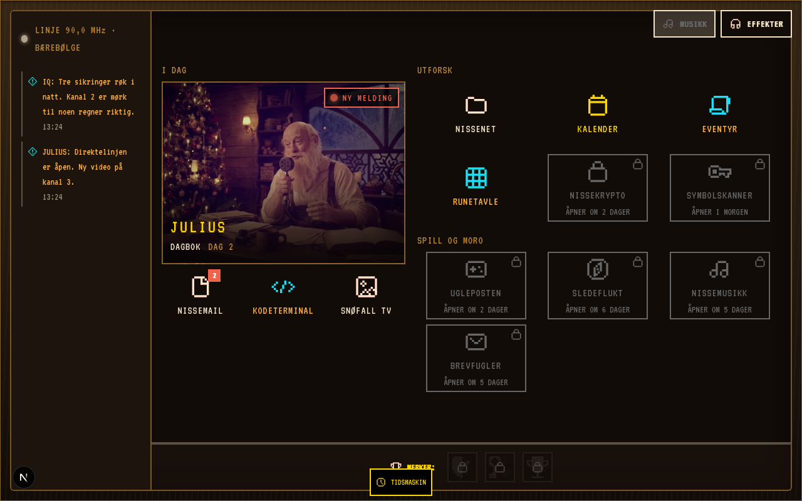
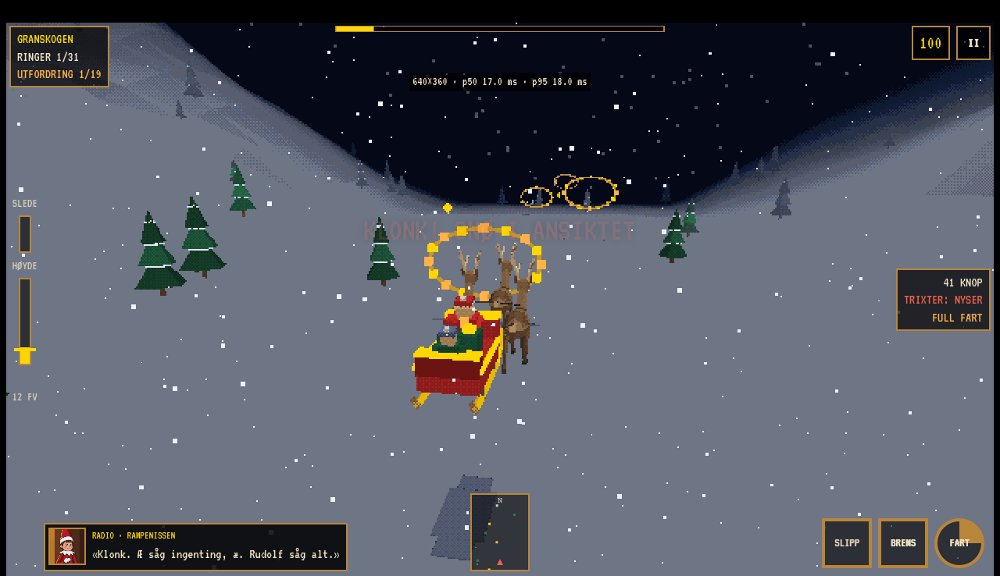
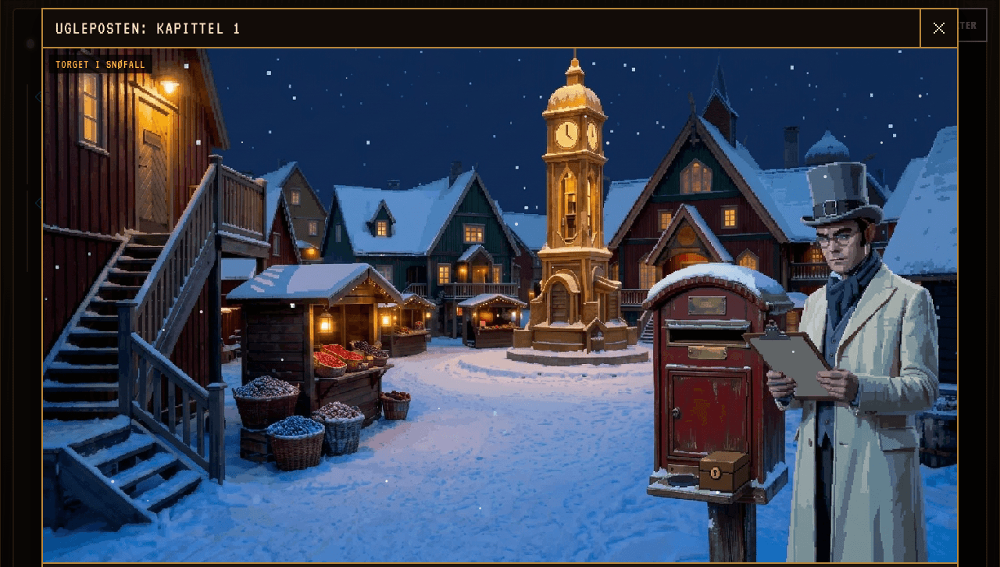
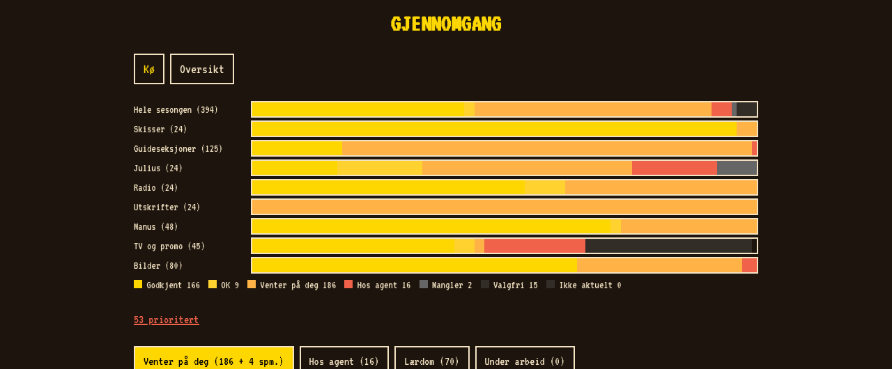

# NisseKomm

> **No spoilers, please! / Ingen spoilere, takk!**
>
> This is one family's advent calendar. The code and the docs in this repository contain the answers to this year's riddles. Please don't tell the kids, and don't read the answers out loud.
>
> Dette er én families julekalender. Koden og dokumentene her inneholder svarene på årets gåter. Ikke si dem til barna, og ikke les dem høyt.

NisseKomm er en julekalender for barn (9-12 år) som blander den fysiske og den digitale verdenen. Rampenissen trenger hjelp til et oppdrag fra Julius (julenissen) i Snøfall. Hver dag 1.-24. desember leter barna etter spor i huset, leser filer i NisseKomm (en retro CRT-terminal), setter bitene sammen og skriver inn en kode. Det digitale er et verktøy for å utforske hjemme, ikke en erstatning.

Sesongen 2026 heter «Operasjon Spøkelseskode».

## Skjermbilder

Barnas skrivebord, en tidlig dag:



SLEDEFLUKT, IQs sledesimulator i retro-piksel 3D:



UGLEPOSTEN, en pek-og-klikk-historie over flere dager:



Gjennomgang i Nissemor-guiden, der foreldre vurderer alt som lages:



## Hva er med

- **Barneappen** (`src/app`, `src/components`): skrivebord med NisseMail, KodeTerminal, NisseNet, Kalender, Eventyr, Julius' videodagbok, Snøfall TV, SLEDEFLUKT, Ugleposten og flere vinduer som låses opp underveis. Koder når aldri nettleseren; de sjekkes på serveren.
- **Nissemor-guiden** (`/nissemor-guide`, bare foreldre): kveldens sjekkliste, hint, utskrifter, gåtekart og **Gjennomgang**, et vurderingsløp der foreldrene godkjenner eller sender tilbake manus, videoer, radio og bilder.
- **Medieløypa** (`assets/`): skript som lager Julius-videoer, TV-løkker, bilder og radio, med kostnadsvakt, sidefiler og versjoner. Mediene ligger utenfor repoet (`MEDIA_DIR`).
- **MCP-integrasjon** (`/mcp`): hjemmeautomasjonen henter dagens kontekst og vurderinger over MCP.

## Teknikk

Next.js 16 (App Router), React 19, TypeScript (strict), Tailwind CSS v4 og PostgreSQL via `/api/state` med `localStorage` som hurtigbuffer. Spilltilstand går alltid gjennom `GameEngine`, og datoer gjennom `lib/date-utils.ts`. Innholdet ligger i `src/data/*.json`.

## Kjøre lokalt

Krever [mise](https://mise.jdx.dev) (Node 24, pnpm 10).

```bash
pnpm install
mise run dev
```

Appen åpner på <http://localhost:3000>. `mise run dev` setter testmodus, dag 10 (bytt med `MOCK_DAY=21 mise run dev`) og start-koder:

- barnekode: `snø lykt rein`
- foreldrekode (`/nissemor-guide`): `NORDPOL-DEV2026`

Dette er bare utviklingskoder. Uten `DATABASE_URL` og Docker bruker serveren en fil i `.data/`. Bruk TIDSMASKIN-knappen nede til høyre for å hoppe mellom dager.

Før commit:

```bash
pnpm check
```

## Dokumentasjon

- [AGENTS.md](./AGENTS.md): start her, inkludert mønstre som alltid gjelder
- [docs/beslutninger.md](./docs/beslutninger.md): logg over valg som er tatt
- [ARCHITECTURE.md](./ARCHITECTURE.md): arkitektur, moduler, tilstand og datoer
- [IMPLEMENTATION.md](./IMPLEMENTATION.md): spillmekanikk og brukerflyt
- [DESIGN_SYSTEM.md](./DESIGN_SYSTEM.md): visuelt språk
- [CONTENT_GUIDE.md](./CONTENT_GUIDE.md): norsk ordliste, karakterstemmer og gåtedesign

## Lisens

MIT, se [LICENSE](./LICENSE).
