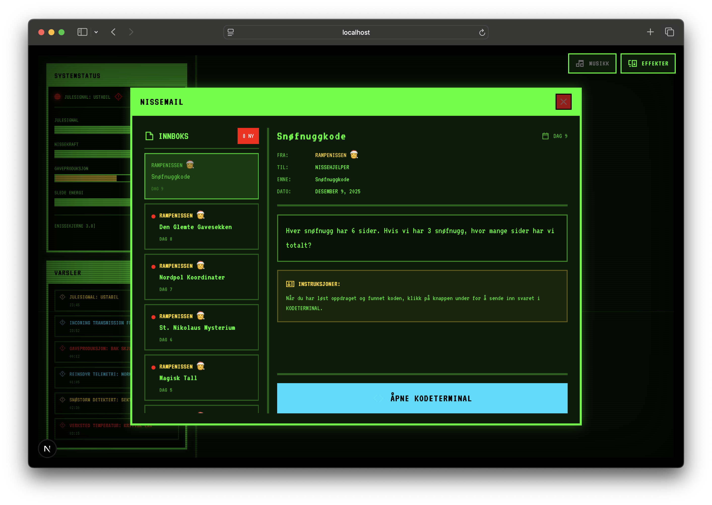

# NisseKomm ❄️🎄

**En magisk julekalender for barn 9-12 år** - Løs daglige gåter, samle symboler og hjelp Julius og nissene i Snøfall!



## 🚀 Prøv NisseKomm - Rampenisse som Tjeneste

**Registrering**: Besøk [https://nissekomm.no/snill-liste](https://nissekomm.no/snill-liste) og bruk registreringskoden `VINTER-KOMMER-67` for å få dine familiekoder.

**Demo-konto**:

- **Nissekode** (barn): `NISSEMORSTJERNE2025`
- **Foreldrekode**: `NORDPOL-T3Q85WXE`

Gå til [https://nissekomm.no](https://nissekomm.no) og skriv inn nissekoden for å starte eventyret med en gang!

## 🎅 Om NisseKomm

**NisseKomm** er ikke bare en digital julekalender - det er kontrollsenteret for en ekte adventsopplevelse der barn (9-12 år) hjelper Rampenissen med et viktig oppdrag fra Julius (julenissen).

Rampenissen, den vennlige men tøysete nissen som holder øye med barna, trenger deres hjelp til å løse daglige gåter som krever utforskning i **BÅDE** den virkelige verden og det digitale hovedkvarteret.

**Konseptet - Broen mellom to verdener**:

Barna får e-post fra Rampenissen hver dag med nye utfordringer. For å løse dem må de:

- 🏠 **Lete etter fysiske ledetråder** i huset (i bøker, bak bilder, i skuffer)
- 💻 **Utforske digitale filer** i NisseKomms retro-terminal
- 🧩 **Kombinere hints fra begge verdener** for å finne løsningen
- 🎁 **Låse opp belønninger** som Julius' dagbok, hemmelige filer og merker

Dette er ikke en 100% digital løsning - suksess krever **fysisk innsats**. De to verdene flettes sammen gjennom hele adventstiden med historier, bonusutfordringer og referanser som bygger på tidligere dager.

## ✨ Funksjoner

### 🎮 5 Spillsystemer

1. **Oppdrag** - 24 fysiske skattejakter kombinert med digital kodeknekkeri
2. **Bonusoppdrag** - Krisetilstander som krever ekstra problemløsning og foreldrevalidering
3. **Eventyr** - To episke historier som bygger på tidligere dager og krever å huske ledetråder
4. **Snill Liste** - Registrer navnet ditt i Julius' offisielle liste (dag 22-24)
5. **Symboler & NisseKrypto** - Finn 9 skjulte QR-kort i huset + løs 3 dekrypteringsutfordringer

### 🖥️ Retro Terminal-Grensesnitt (NisseKomm HQ)

- **CRT-effekter**: Autentiske skannelinjer, pikselkanter og glød
- **6 kjernemodeller**: NisseMail, KodeTerminal, NisseNet, Kalender, Eventyr, Julius' Dagbok
- **4 opplåsbare modeller**: NisseKrypto, SymbolSkanner, NisseMusikk, Brevfugler
- **Fysiske elementer**: QR-kort som foreldre printer og gjemmer rundt i huset
- **Interaktiv feedback**: Lyder, animasjoner og visuell respons

### 🎄 Snøfall-Universet

Basert på TV-serien **Snøfall** med kjente karakterer:

- **Julius** (julenissen) - Vis og varm leder
- **Rampenissen** - Din entusiastiske, litt klønete venn
- **Hjerterud** - Driver bakeriet og kafeen, varm og litt overveldende
- **Pil, Winter, IQ** - Nisser med spesialoppgaver
- **Orakelet & Mørket** - Mystikk og spenning

## 🚀 Komme i Gang

### 1. Installasjon

```bash
# Klon prosjektet
git clone https://github.com/starefossen/NisseKomm.git
cd NisseKomm

# Installer avhengigheter
pnpm install
```

### 2. Konfigurasjon (valgfritt)

Opprett `.env.local` for testing og utvikling:

```bash
# Testmodus - Omgå datobegrensninger
NEXT_PUBLIC_TEST_MODE=false

# Oppstartsanimasjon (sekunder, 0 = hopp over)
NEXT_PUBLIC_BOOT_ANIMATION_DURATION=2

# Simuler spesifikk dag (1-24)
NEXT_PUBLIC_MOCK_DAY=

# Simuler spesifikk måned (1-12)
NEXT_PUBLIC_MOCK_MONTH=


# Registrering tilgangskontroll (valgfritt, for privat deling)
REGISTRATION_SHARE_KEY=     # Tom = åpen registrering, satt verdi = krever nøkkel

# Sanity CMS (påkrevd hvis STORAGE_BACKEND=sanity)
NEXT_PUBLIC_SANITY_PROJECT_ID=
NEXT_PUBLIC_SANITY_DATASET=production
NEXT_PUBLIC_SANITY_API_VERSION=2024-11-01
SANITY_API_TOKEN=
```

### 3. Registrer Familie (lokal utvikling)

Besøk [http://localhost:3000/register](http://localhost:3000/register) for å:

- Opprett familiekonto
- Få tildelt **Nissekode** (barn bruker denne)
- Få tildelt **Foreldrekode** (for foreldreveiledning)

### 4. Kjør Utviklingsserver

```bash
pnpm dev
```

Åpne [http://localhost:3000](http://localhost:3000) og bruk din **Nissekode**

### 5. Foreldreveiledning

Besøk **/nissemor-guide** i nettleseren og logg inn med din **foreldrekode** for:

- 🎁 **Hovedside**: Administrer oppdrag og moduler
- 🎯 **Symboler**: Print og skjul QR-kort rundt i huset
- 📖 **Eventyr**: Følg med på barnas fremdrift i historiene

## 📚 Dokumentasjon

### For AI Utviklere

- 🤖 **[AGENTS.md](./AGENTS.md)** - Rask-start guide (du starter her!)
- 📐 **[ARCHITECTURE.md](./ARCHITECTURE.md)** - Teknisk arkitektur og mønstre
- 🎮 **[IMPLEMENTATION.md](./IMPLEMENTATION.md)** - Spillmekanikk og brukerflyt
- 🎨 **[DESIGN_SYSTEM.md](./DESIGN_SYSTEM.md)** - Visuelt språk og stilguide
- ✍️ **[CONTENT_GUIDE.md](./CONTENT_GUIDE.md)** - Skriveretningslinjer og karakterstemmer

### For Utviklere

#### Kvalitetskontroll

Kjør alltid før commit:

```bash
pnpm check
```

Dette kjører TypeScript, ESLint, Knip og Prettier.

#### Rediger Innhold

Oppdrag og innhold er strukturert i JSON-filer:

```text
src/data/
├── uke1_oppdrag.json  # Dag 1-6
├── uke2_oppdrag.json  # Dag 7-12
├── uke3_oppdrag.json  # Dag 13-18
├── uke4_oppdrag.json  # Dag 19-24
├── eventyr.json       # To hovedhistorier
├── merker.json        # Badges og prestasjoner
└── statisk_innhold.json  # Filsystem og systeminnhold
```

**Eksempel oppdrag-struktur**:

```json
{
  "dag": 1,
  "tittel": "Velkommen til Snøfall",
  "kode": "JULESTJERNE",
  "gaate": "Jeg skinner i toppen...",
  "fysiskLedetrad": "Se etter noe som lyser høyt oppe",
  "nissemailInnhold": "Hei! Velkommen til terminalen...",
  "dagbokinnlegg": "I dag startet et magisk eventyr...",
  "hints": ["Hint 1", "Hint 2", "Hint 3"]
}
```

#### Prosjektstruktur

```text
src/
├── app/                    # Next.js sider
│   ├── page.tsx           # Hovedapplikasjon (desktop)
│   ├── globals.css        # CRT-effekter og animasjoner
│   └── nissemor-guide/    # Foreldrekontrollpanel
├── components/
│   ├── windows/           # Hovedvinduer (NisseMail, KodeTerminal, etc.)
│   ├── modules/           # Sidepanel-widgets
│   ├── ui/                # Gjenbrukbare komponenter
│   └── nissemor/          # Foreldreveiledning komponenter
├── lib/
│   ├── game-engine.ts     # 🚨 HOVEDINNGANG - All spilllogikk
│   ├── date-utils.ts      # 🚨 KRITISK - Sentralisert datohåndtering
│   ├── storage.ts         # localStorage abstraction
│   ├── systems/           # Domenelogikk (symboler, etc.)
│   ├── generators/        # Innholdsgenerering (alerts)
│   └── validators/        # Datavalidering
└── data/                   # Oppdragsinnhold (enkelt å redigere)
```

## 🎨 Design & Stil

### Fargepalett

| Farge        | Hex       | Bruksområde              |
| ------------ | --------- | ------------------------ |
| 💚 Neongrønn | `#00ff00` | Primær UI, suksess       |
| ❤️ Julerød   | `#ff0000` | Feil, advarsler          |
| ⭐ Gull      | `#ffd700` | Fullføring, prestasjoner |
| 💙 Kald blå  | `#00ddff` | Info, hint               |
| 🖤 Mørk CRT  | `#0a1a0a` | Bakgrunn                 |
| 🩶 Grå       | `#666666` | Låst, deaktivert         |

### Typografi

**VT323** - Monospace pixel-font fra Google Fonts

### Interaksjonsprinsipper

- ✨ **Leken, ikke realistisk** - Overdrevne animasjoner
- 🔊 **Hver handling gir feedback** - Lyd + animasjon
- ⏱️ **Falske forsinkelser** - 1,5s "tenking" for retro-følelse
- 🎯 **Touch-optimalisert** - Minimum 44×44px trykkareal
- 🇳🇴 **Norsk språk** - All UI-tekst på norsk

## 🛠️ Teknisk Stakk

- **Next.js 16** - App Router
- **React 19** - Funksjonelle komponenter
- **TypeScript** - Streng modus
- **Tailwind CSS v4** - Utility-first styling
- **localStorage** - Persistering (via StorageManager)
- **Web Audio API** - Retro-lydeffekter

### Kritiske Arkitekturmønstre

#### 🚨 Facade Pattern

**GameEngine er ENESTE inngang for spilltilstand.**

```typescript
// ❌ FEIL - UI tilgang til StorageManager
const completedDays = StorageManager.getCompletedDaysForMissions();

// ✅ RIKTIG - UI kaller GameEngine
const completedDays = GameEngine.getCompletedDays();
```

#### 🚨 Sentralisert Datohåndtering

**ALDRI bruk `new Date()` direkte.**

```typescript
// ❌ FEIL
const today = new Date();

// ✅ RIKTIG
import { getCurrentDay } from "@/lib/date-utils";
const currentDay = getCurrentDay();
```

📖 Les mer i [AGENTS.md](./AGENTS.md) og [ARCHITECTURE.md](./ARCHITECTURE.md)

## 🎯 Målgruppe

- **Alder**: 9-12 år
- **Språk**: Norsk
- **Familie-aktivitet**: Foreldre og barn samarbeider
- **Periode**: 1-24. desember
- **Tid per dag**: 15-30 minutter

## 📄 Lisens

MIT License - Se [LICENSE](./LICENSE) for detaljer.

## 🙏 Bidrag

Bidrag er velkomne! Vennligst:

1. Fork prosjektet
2. Opprett en feature branch (`git checkout -b feature/AmazingFeature`)
3. Commit endringer (`git commit -m 'Add some AmazingFeature'`)
4. Push til branch (`git push origin feature/AmazingFeature`)
5. Åpne en Pull Request

**Før du sender PR**:

- Kjør `pnpm check` (ingen feil eller advarsler)
- Oppdater dokumentasjon ved arkitekturendringer
- Hold all UI-tekst på norsk
- Følg eksisterende kodestil

## 🎄 God Jul

Laget med ❤️ for norske barn og familier. Må koden din alltid være bugfri og julestemningen høy! 🎅✨

---

**Versjon**: Fase 1
**Sist oppdatert**: November 2025
**Vedlikeholdt av**: AI Coding Agents
