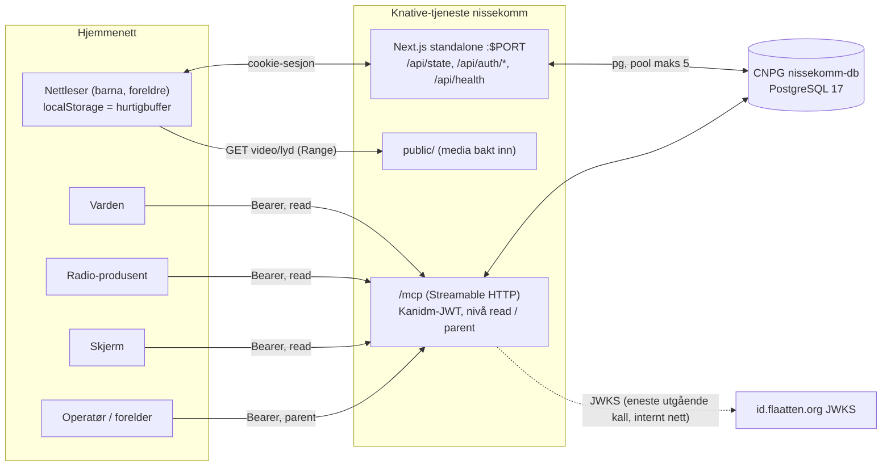

# Fase 5: NisseKomm flytter til hjemmeklyngen

Plan, 10. november 2026. Krav: `todo.md` fase 5 (Varden, Starefossen/homelab#22). Oppgavene P1–P7 i `docs/arkitektur-2026.md` §5 er brutt ned videre her.

## 1. Målarkitektur



Merk: JWKS-hentingen er det eneste utgående kallet. `id.flaatten.org` må være nåbar fra navnerommet i CiliumNetworkPolicy, ellers må nøklene bakes inn eller hentes via intern adresse. Avklares med Varden.

## 2. Lagring

### Prinsipp

`StorageManager` er synkron og har rundt 90 kallsteder via `GameEngine`. Den skal ikke skrives om. Vi gjør som `SanityStorageAdapter` gjorde, bare enklere:

- localStorage er fortsatt hurtigbuffer i nettleseren. Alle lesinger er synkrone som før.
- Ved innlogging og oppstart: `GET /api/state` henter alle nøkler og skriver dem inn i localStorage før spillet tegnes.
- Ved skriving: `PUT /api/state` med `{ key, value }` (fire-and-forget, med én ny forsøk ved feil). Serveren er sannheten; siste skriving vinner per nøkkel.
- Én familie, så ingen sesjons-ID i nøkkelen.

Ny `ServerSyncAdapter` (erstatter `SanityStorageAdapter`, ca. 60 linjer) i `storage-adapter.ts`. `createStorageAdapter` velger på `NEXT_PUBLIC_STORAGE_BACKEND`: `server` (produksjon) eller `localStorage` (dev, test, nødmodus).

### Hva flyttes

Synkroniseres til Postgres (hvitliste i serveren, alt annet avvises):

| Nøkkel (`storage.ts` KEYS)                                                                                                                                  | Hvorfor                                   |
| ----------------------------------------------------------------------------------------------------------------------------------------------------------- | ----------------------------------------- |
| `nissekomm-codes`                                                                                                                                           | Fremdrift, `get_progress`, frost          |
| `nissekomm-julius-watched`                                                                                                                                  | Video sett, `get_clips`, PS-varianter     |
| `nissekomm-bonusoppdrag-completed`, `nissekomm-earned-badges`                                                                                               | Bonus                                     |
| `nissekomm-brevfugler`                                                                                                                                      | Brev til Julius                           |
| `nissekomm-frost-off-day`                                                                                                                                   | Nødstopp for frost, settes av `set_frost` |
| `nissekomm-collected-symbols`, `-solved-decryptions`, `-unlocked-files`, `-topic-unlocks`, `-player-names`, `-viewed-emails`, `-viewed-bonusoppdrag-emails` | Samme spill på flere skjermer             |

Blir bare lokale: `authenticated`, lyd/musikk på-av, `failed-attempts`, `decryption-attempts`, `nissenet-last-visit`, `nice-list-viewed`, og Tidsmaskin-nøkkelen i `date-utils.ts`.

### Skjema

```sql
CREATE TABLE IF NOT EXISTS kv (
  key        text PRIMARY KEY,
  value      jsonb NOT NULL,
  updated_at timestamptz NOT NULL DEFAULT now()
);
CREATE TABLE IF NOT EXISTS schema_version (version int PRIMARY KEY);
```

Én nøkkel-verdi-tabell holder. Spilltilstanden er noen få kB, én familie, og formen er allerede JSON i localStorage. Egne tabeller per begrep gir ingenting MCP trenger: `get_progress` leser `nissekomm-codes` og `nissekomm-julius-watched`.

Frost-overstyring fra MCP (`set_frost(active, until)`) lagres som nøkkelen `frost-override` (`{ active, until }`), som klienten leser ved henting og `frostModeFor` tar hensyn til.

### Migreringer

`src/lib/db.ts`: `pg.Pool({ connectionString: DATABASE_URL, max: 5 })` og `migrate()` som kjører `CREATE TABLE IF NOT EXISTS` i en transaksjon med `pg_advisory_xact_lock`. Kalles fra `instrumentation.ts` (`register()`, bare `nodejs`-runtime). Tåler flere kjøringer og to pods samtidig. `/api/health` rører ikke databasen.

### Server-API

- `GET /api/state` → `{ [key]: value }` for hvitlisten.
- `PUT /api/state` `{ key, value }` → upsert. Hvitliste, maks størrelse (f.eks. 64 kB).
- Begge krever innloggingscookien fra `/api/auth/login` (HMAC-signert, nøkkel fra `KID_CODE`/`PARENT_CODE` eller egen `SESSION_SECRET`).

Route handlers, ikke server actions: adapteren er vanlig klientkode utenfor React, og ruter er enklere å teste med jest.

### Tidsmaskin og tester

- Tidsmaskin blir i localStorage og påvirker bare den nettleseren. Riktig for testing.
- `skip_day` (MCP) kan ikke bruke Tidsmaskin. Den lagres som `day-offset` i `kv` og legges til i `getCurrentDay()` etter henting. Ikke i P4; hører til P6.
- Jest bruker `LocalStorageAdapter` (jsdom) som i dag. `db.ts` testes mot `pg-mem` eller hoppes over uten `DATABASE_URL`. Ingen ny tung avhengighet: holder med én test av `/api/state` med mocket `db`.
- `mise run dev` bruker `localStorage`. Ny `mise run dev:pg` starter Postgres i Docker og kjører med `server`.

## 3. Fjernes (sjekket med grep 10. nov)

`api/home-bridge` finnes ikke lenger i `src/app/api` (allerede fjernet).

**API-ruter** (`src/app/api/`): `auth/{family,recover,register,share-key-required}`, `family`, `session` (+ `friends`, `kid-code`, `sync`), `settings/{delete-account,email-subscription}`, `unsubscribe`, `cron/send-daily-emails`, og testene i deres `__tests__`. `auth/login` og `auth/verify` skrives om (P3), ikke slettes.

**Bibliotek** (`src/lib/`): `sanity-client.ts`, `session-manager.ts`, `email-service.ts`, `code-generator.ts`, `api-utils.ts`, `password-utils.ts`, `analytics.ts`, `__mocks__/@vercel/analytics.ts`, `__mocks__/uuid.ts`, `SanityStorageAdapter` i `storage-adapter.ts`, `getFriendNames`/`setFriendNames` og `waitForPendingSyncs` i `storage.ts`.

**Må redigeres (importerer noe som slettes):** `app/layout.tsx` (Analytics), `app/nissemor-guide/innstillinger/page.tsx`, `components/nissemor/GuideSettings.tsx`, `GuideAuth.tsx`, `components/ui/PasswordPrompt.tsx`, `lib/app-context.tsx`, `lib/game-engine.ts`, `lib/date-utils.ts`.

**Sider:** `app/snill-liste/` (familieregistrering).

**Skript og oppsett:** `scripts/{send-daily-mission-emails,send-welcome-emails,leaderboard,cleanup-test-sessions}.ts`, `migrations/`, `sanity/`, `sanity.config.ts`, `sanity.cli.ts`, `vercel.json` (hodene flyttes til `next.config.ts` først), `test-multi-tenant.sh`, `mise.toml`-oppgaven `dev:sanity`, `package.json`-skriptene `cleanup:*`, `email:*`, `leaderboard:*`, `migration:*`, `sanity*`.

**Avhengigheter:** `@sanity/client`, `@sanity/vision`, `sanity`, `@sanity/migrate`, `styled-components`, `resend`, `@vercel/analytics`, `uuid`. Nye: `pg`, `@types/pg`, `jose`, `@modelcontextprotocol/sdk`.

**Miljøvariabler ut:** `NEXT_PUBLIC_SANITY_*`, `SANITY_API_TOKEN`, `RESEND_API_KEY`, `RESEND_FROM_EMAIL`, `NEXT_PUBLIC_ENABLE_ANALYTICS_IN_DEV`, `CRON_SECRET` om den finnes. Inn: `PORT`, `DATABASE_URL`, `KID_CODE`, `PARENT_CODE`, `NEXT_PUBLIC_URL`. `HOME_STATE_TOKEN` fra todo.md trengs ikke når MCP bruker Kanidm-JWT; avklares.

Kontroll etter P1: `grep -rniE "sanity|resend|@vercel|uuid|session-manager" src scripts package.json` gir null treff, og `knip` er grønn.

## 4. Oppgaver

| #   | Oppgave                        | Leveranser                                                                                                                                                                                                          | Filer                                                                                                                              | Avhenger av                  |
| --- | ------------------------------ | ------------------------------------------------------------------------------------------------------------------------------------------------------------------------------------------------------------------- | ---------------------------------------------------------------------------------------------------------------------------------- | ---------------------------- |
| T1  | Kjøring                        | `output: "standalone"`, sikkerhetshoder i `headers()`, `GET /api/health`                                                                                                                                            | `next.config.ts`, `src/app/api/health/route.ts`, slett `vercel.json`                                                               | –                            |
| T2  | Image                          | Dockerfile (`node:24-alpine`, flertrinns, ikke-root, `PORT` 8080, `HOSTNAME=0.0.0.0`), `.dockerignore`, mise-oppgave `image:push` (buildx amd64+arm64, tag `<unix-ts>`)                                             | `Dockerfile`, `.dockerignore`, `mise.toml`                                                                                         | T1                           |
| T3  | Slett flerbruker               | Rutene, bibliotekene, sidene og skriptene i §3; `package.json` uten avhengighetene                                                                                                                                  | `src/app/api/*` (ikke `auth/login`, `auth/verify`), `src/lib/*`, `scripts/`, `package.json`                                        | –                            |
| T4  | Én familie                     | `auth/login` og `auth/verify` mot `KID_CODE`/`PARENT_CODE` (konstant-tid sammenligning), signert cookie; `PasswordPrompt`/`GuideAuth`/`GuideSettings` uten familiedel                                               | `src/app/api/auth/*`, `src/components/ui/PasswordPrompt.tsx`, `src/components/nissemor/*`, `src/app/nissemor-guide/innstillinger/` | T3                           |
| T5  | Postgres                       | `src/lib/db.ts` (pool, `migrate()` med advisory lock), `instrumentation.ts`, `GET/PUT /api/state` med hvitliste og test                                                                                             | `src/lib/db.ts`, `src/instrumentation.ts`, `src/app/api/state/*`                                                                   | T3, T4 (cookie)              |
| T6  | Klientsynk                     | `ServerSyncAdapter`, henting før første tegning, `STORAGE_BACKEND=server\|localStorage`, `mise run dev:pg`                                                                                                          | `src/lib/storage-adapter.ts`, `src/lib/storage.ts`, `src/lib/app-context.tsx`, `mise.toml`                                         | T5                           |
| T7  | MCP `read` + auth              | `/mcp` med `@modelcontextprotocol/sdk`, `jose` mot Kanidm JWKS (audience `mcp`, gruppe → nivå), `get_state`, `get_clips`, `get_today_quest`, `get_progress`; test som sjekker alle svar mot alle 24 koder og `hint` | `src/app/mcp/route.ts`, `src/lib/mcp/*`                                                                                            | T5                           |
| T8  | MCP `parent`                   | `give_hint`, `set_frost`, `skip_day`, `reset`; lyd via GET med samme Bearer; `day-offset` og `frost-override` lest av klienten                                                                                      | `src/lib/mcp/*`, `src/lib/frost.ts`, `src/lib/date-utils.ts`                                                                       | T6, T7                       |
| T9  | Dokumentasjon                  | AGENTS.md, ARCHITECTURE.md, `.env.local.example`, Tidsmaskin beskrevet                                                                                                                                              | `*.md`, `.env.local.example`                                                                                                       | T6, T8                       |
| T10 | Subtree til `starefossen/home` | `git subtree add --prefix apps/nissekomm`, arkiver repoet                                                                                                                                                           | annet repo                                                                                                                         | alt, og ingen agenter aktive |

**Adversarial gjennomgang av en annen modell før merge:** T4 (innlogging og cookie), T7 og T8 (MCP og JWT). Hold auto-merge av til dommen gjelder akkurat dette hodet.

**Parallelle runder (maks 4, ingen delte filer):**

1. T1, T3 (T3 eier `package.json`, T1 rører den ikke).
2. T2, T4.
3. T5.
4. T6, T7 (T6 eier `storage*`/`app-context`, T7 eier `src/lib/mcp` og `src/app/mcp`; `package.json`-tillegg for `jose` og MCP-SDK gjøres i T7, `pg` i T5).
5. T8.
6. T9. T10 etter 6. januar eller når hjemmeoppsettet er stabilt.

**Kritisk sti:** T3 → T4 → T5 → T6/T7 → T8 → T9. Seks runder; med én runde per dag og gjennomgang er det trangt mot 28. november.

## 5. Risiko for 1. desember og reserveplan

1. **Synk mister data eller overskriver** (to skjermer, siste skriving vinner per nøkkel, f.eks. `nissekomm-codes` som liste). Tiltak: serveren slår sammen lister for `codes`, `julius-watched`, `bonusoppdrag-completed` og `brevfugler` (union på dag) i stedet for å erstatte.
2. **Kald start og nettverk.** Knative med `minScale=1` i desember dekker kald start. Mislykket `GET /api/state` skal ikke stoppe spillet: klienten fortsetter på localStorage og prøver igjen.
3. **JWKS nås ikke fra klyngen** (egress-policy). MCP svarer 401 og hjemmeintegrasjonen er død, men selve spillet påvirkes ikke.
4. **Lekkasje via MCP** (koder, `hint`, fremtidige dager). Testen mot alle 24 koder og adversarial gjennomgang før merge.
5. **Bygge-tids-variabler** (`NEXT_PUBLIC_*` bakes inn): et image bygd med `MOCK_DAY` eller `TEST_MODE` i produksjon. Tiltak: `image:push` nekter å bygge hvis de er satt.

**Reserve:** `NEXT_PUBLIC_STORAGE_BACKEND=localStorage` forblir et gyldig valg i produksjonsimaget fram til Postgres har kjørt en full generalprøve (steg 6, 29.–30. nov). Siden valget bakes inn ved bygging, bygges og tagges begge variantene; bytte er en ny utrulling med den andre taggen. I localStorage-modus virker spillet fullt ut; bare MCP-verktøyene som leser fremdrift mangler data. Spillet er aldri avhengig av at databasen svarer for å vise dagens oppdrag.

## Avgjørelser som trengs

1. Skal Skjerm hente frost via MCP `get_state` eller et eget `GET /api/frost` (arkitektur §4 punkt 9)?
2. Trengs `HOME_STATE_TOKEN` når MCP bruker Kanidm-JWT? Forslag: fjern.
3. Hvilke Kanidm-grupper gir `read` og `parent`?
4. Synker vi også nøkler som «sett e-post» og symboler mellom skjermer, eller bare fremdrift (minste mulige)? Planen synker alt i tabellen over.

## Avgjort 10. november

- **Synk:** alt spilltilstand deles mellom skjermer (løste koder, sette videoer, bonus, brev til Julius, runetavle, innstillinger). Serveren slår sammen lister per dag.
- **Skjerm** henter frost fra MCP `get_state`. `HOME_STATE_TOKEN` og `/api/frost` utgår.
- **MCP-autentisering (fra Varden):** kaller identifiseres med `sub` (UUID for tjenestekonto), ikke grupper. Porten er `iss` + `aud` + scope.
  - Utsteder `https://id.flaatten.org/oauth2/openid/mcp`, audience `mcp`, påkrevd scope `groups`, alg ES256, typ `at+jwt`, klokkeslingring cirka 60 s.
  - JWKS hentes i kjøring fra `https://id.flaatten.org/oauth2/openid/mcp/public_key.jwk`, med mellomlagring, periodisk oppfrisking og ny henting ved ukjent `kid`. Ingen innbakte nøkler. Når ingen nøkler er lastet (kaldstart), vent på eller utfør første henting før tokenet vurderes.
  - Kallere i konfigurasjon (miljø eller montert JSON), ikke i kode, på formen `{issuer, audience, jwks_url, required_scope, callers: {uuid: navn}}` pluss nivå per navn. Ukjent `sub` gir 401.
  - Kjente kallere: `varden-jwt` `071d4ebd-89ba-445b-80a6-c1bfd5e756ba` (read), `operator-jwt` `00e6aa3b-4146-4ea1-9a81-0498eb2585d6` (parent), `radio-producer-jwt` `5020e366-5eed-49e1-8384-0e114f310dba` (read). `svc-skjerm` (read) og en foreldreidentitet (parent) kommer fra Varden senere.
